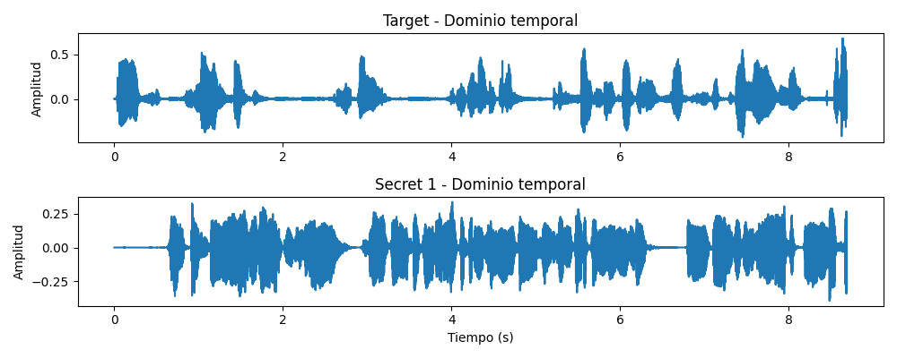
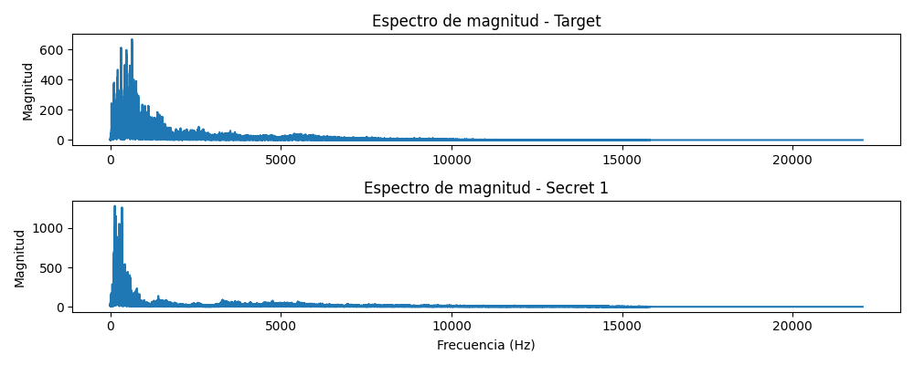
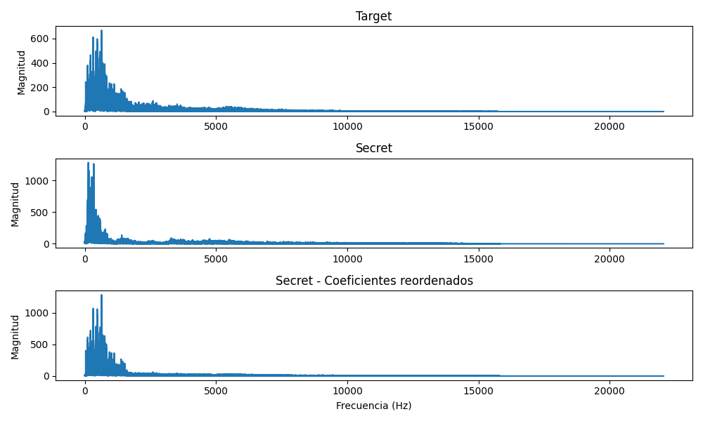
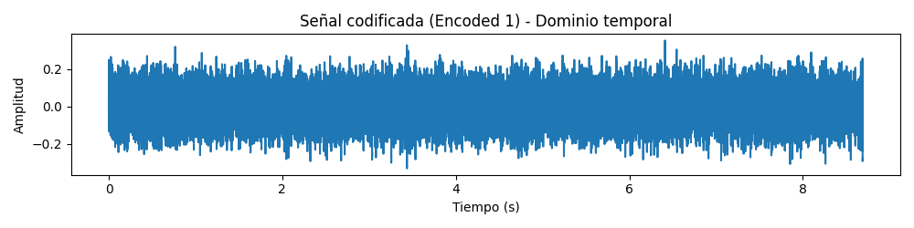

# 🎧 Proyecto de Análisis de Señales — Ocultamiento y Recuperación Espectral (*Imitation* y *Reverse*)

Proyecto en Python que oculta cinco mensajes de audio mediante la permutación biyectiva de sus coeficientes espectrales complejos de Fourier (**Imitation**), los recupera aplicando la permutación inversa (**Reverse**) y evalúa cuantitativamente la calidad de las señales reconstruidas mediante **SNR** y **Correlación de Pearson**.

---

## 📂 Estructura del repositorio

```text
Proyecto_Analisis_Senales/
├── audios/
│   ├── originales/                # Audios fuente: target.wav y secret1..5.wav
│   ├── encoded/                   # Audios codificados: encoded_1..5.wav
│   └── recovered/                 # Audios recuperados: recovered_1..5.wav
├── keys/                          # Claves de permutación: FFT_key_1..5.csv
├── imitation.py                   # Paso 1: codificación espectral (genera encoded + claves)
├── reverse.py                     # Paso 2: recuperación espectral (genera recovered)
├── metricas.py                    # Paso 3: cálculo de SNR, Pearson y generación de gráficas
├── Grafica_tiempo.png             # Comparación temporal de Target y Secret 1
├── Grafica_espectro.png           # Espectros de magnitud rFFT de Target y Secret 1
├── Grafica_espectro_ordenado.png  # Espectro original vs. reorganizado de Secret 1
├── Grafica_encoded.png            # Señal codificada en el dominio temporal
├── EXPLICACION_IMITATION.md       # Desarrollo matemático paso a paso de imitation.py
└── README.md                      # Documentación, resultados y análisis del proyecto
```

---
[](https://colab.research.google.com/github/JEFF206FFF/Proyecto_senales/blob/main/Ejecutar_en_Colab.ipynb)
## ▶️ Orden de ejecución

```bash
pip install numpy scipy matplotlib
python imitation.py
python reverse.py
python metricas.py
```

---

## 🧩 Parte I. Imitation — Análisis Temporal y Espectral

### 🎙️ 1. Carga y exploración temporal



**Análisis temporal (`Target` vs. `Secret`):**
* **Amplitud:** Ambas señales están escaladas en el rango físico normalizado $[-1.0, 1.0)$, pero presentan envolventes y picos de amplitud distintos debido a diferencias en la intensidad vocal y la dinámica de grabación de cada locutor.
* **Pausas y distribución de actividad:** Tanto el *Target* como los *Secrets* corresponden a señales de voz humana, caracterizadas por ráfagas de energía (sílabas y palabras) separadas por pausas de silencio casi nulo entre frases. Sin embargo, los instantes en los que ocurren dichos silencios y la duración de las pausas no coinciden temporalmente entre el audio de referencia y los mensajes secretos.

---

### 📊 2. Análisis espectral (`rfft`)



**Análisis espectral:**
* **Regiones de mayor magnitud y picos principales:** En ambas señales, la mayor concentración de energía espectral se ubica en las frecuencias bajas y medias (principalmente entre $100\ \text{Hz}$ y $3\,500\ \text{Hz}$, banda fundamental de la voz humana y sus formantes), disminuyendo progresivamente hacia las altas frecuencias cercanas a Nyquist ($22\,050\ \text{Hz}$). No obstante, la ubicación exacta de los picos armónicos difiere entre *Target* y *Secret* según el tono fundamental de cada hablante.
* **Información compleja:** Cada coeficiente devuelto por `rfft` es un número complejo $X[k] = a_k + j b_k$ que codifica simultáneamente la **magnitud** $|X[k]|$ (energía presente en esa frecuencia) y la **fase** $\phi[k]$ (alineación temporal de las ondas).

---

### 🔀 3. Reorganización de coeficientes complejos



**Por qué el espectro reorganizado imita al *Target* conservando las magnitudes del *Secret*:**
* La clave de permutación `K` (`K[P[I2]] = P[I1]`) empareja los índices ordenados de menor a mayor magnitud: coloca el coeficiente complejo del *Secret* con menor magnitud en la frecuencia donde el *Target* tiene su menor magnitud, y así sucesivamente hasta ubicar el pico máximo del *Secret* en la frecuencia donde el *Target* tiene su pico máximo.
* Como `E = S[K]` únicamente **reubica** los coeficientes complejos completos de `S` sin multiplicar ni alterar sus valores reales o imaginarios (manteniendo fijos DC en $k=0$ y Nyquist en $k=N/2$), el conjunto de magnitudes del espectro reorganizado es exactamente el mismo del *Secret* original, pero su distribución frecuencial adopta la envolvente del *Target*.

---

### 🔊 4. Generación del audio codificado (`irfft`)



**Comportamiento temporal de `encoded.wav`:**
* Al aplicar `irfft` sobre el espectro permutado, las relaciones de fase originales del *Secret* quedan completamente desordenadas respecto a sus nuevas frecuencias. En consecuencia, desaparecen las pausas de silencio del habla original y la energía se dispersa de manera casi uniforme a lo largo de toda su duración ($8.69\ \text{s}$), percibiéndose auditivamente como ruido continuo e ininteligible.

---

## 📏 Parte III. Evaluación de la Calidad (*Reverse*)

### 📊 Tabla de resultados

| Mensaje secreto | SNR (dB) | Correlación de Pearson |
| :--- | :---: | :---: |
| Secret 1 | 152.42 | 1.000000000000 |
| Secret 2 | 152.21 | 1.000000000000 |
| Secret 3 | 152.41 | 1.000000000000 |
| Secret 4 | 152.37 | 1.000000000000 |
| Secret 5 | 152.27 | 1.000000000000 |

### 🔎 Análisis de calidad de reconstrucción

1. **Comparación entre los cinco mensajes:**
   * Los cinco mensajes presentan una reconstrucción prácticamente idéntica al original, con valores de **SNR superiores a $150\ \text{dB}$** y un **coeficiente de correlación de Pearson $\rho = 1.000000000000$** (diferencias del orden de $10^{-15}$ respecto a $1$).
   * El mensaje que obtiene el mayor SNR corresponde al que presenta menor energía de error relativa $\sum_{n=0}^{N-1} (x[n] - \hat{x}[n])^2$ respecto a su propia energía total $\sum_{n=0}^{N-1} x[n]^2$. Las ligeras variaciones de décimas de dB entre los cinco secretos se explican por las diferencias en la energía RMS y el factor de cresta (picos máximos de amplitud) de cada grabación original frente al piso de redondeo numérico.
2. **Interpretación conjunta de SNR y Pearson:**
   * El **SNR** mide la relación logarítmica entre la potencia de la señal útil y la potencia del error muestra a muestra; valores por encima de $150\ \text{dB}$ indican que el ruido de reconstrucción está más de siete órdenes de magnitud por debajo de la señal original, siendo totalmente imperceptible para el oído humano.
   * La **correlación de Pearson ($\rho \approx 1.0$)** confirma que la forma de onda recuperada $\hat{x}[n]$ conserva exactamente la misma estructura temporal, alineación de fase y linealidad que $x[n]$, sin desfases ni distorsiones de envolvente.
3. **Por qué aparecen pequeños errores tras guardar y cargar el audio digital:**
   * Matemáticamente, la permutación `K` es una biyección exacta (`X_recovered[K] = E = S[K]`), por lo que en memoria de punto flotante de 64 bits (`float64`, 53 bits de mantisa) el error de reconstrucción sería cercano al épsilon de máquina ($\approx 10^{-16}$, equivalente a un $\text{SNR} > 300\ \text{dB}$).
   * Sin embargo, al guardar `encoded.wav` y `recovered.wav` en disco en formato WAV IEEE de **32 bits (`float32`, 24 bits de mantisa)** y volverlos a cargar, cada muestra sufre una **cuantización por redondeo** al bit menos significativo ($\approx 10^{-8}$). Este mínimo error de precisión finita se propaga a través de la `rfft` e `irfft` durante `reverse.py`, explicando por qué el SNR se estabiliza alrededor de $152\ \text{dB}$ en lugar de tender a infinito.

---

## 📄 Documentación complementaria

Para el desarrollo matemático y computacional paso a paso de `imitation.py` (variables, escalado PCM, `rfft`, índices fijos DC/Nyquist y ejemplo numérico), consulta [EXPLICACION_IMITATION.md](EXPLICACION_IMITATION.md).

---

## 👥 Autores

* **Jefferson Arley Fontecha Soler** — Ingeniería en Telecomunicaciones, Universidad Militar Nueva Granada
* **Juan Pablo Cano Chávez** — Ingeniería en Telecomunicaciones, Universidad Militar Nueva Granada
* **Samuel Tomas Daza Cordero** — Ingeniería en Telecomunicaciones, Universidad Militar Nueva Granada
